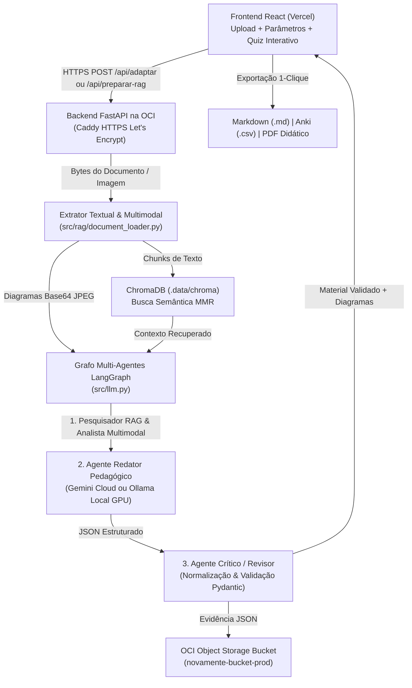

# 🎓 NovaMente

### Sistema Inteligente de Adaptação e Geração de Conteúdo Educacional

**Hackathon ONE G10 — Oracle Next Education & Alura**

🌐 **Aplicação em Produção (Vercel):** [https://g10brasilequipe6novamente-frontend.vercel.app/](https://g10brasilequipe6novamente-frontend.vercel.app/)  
⚡ **API Backend em Produção (Oracle Cloud HTTPS):** [https://137-131-213-187.sslip.io/](https://137-131-213-187.sslip.io/)

> **Status do projeto:** Aplicação em Produção com Frontend React + Vite na **Vercel**, Backend FastAPI com HTTPS (Let's Encrypt) em **VM Compute na Oracle Cloud (OCI)**, Persistência de Evidências no **OCI Object Storage**, Infraestrutura como Código com **Terraform**, Orquestração **Multi-Agentes com LangGraph**, **RAG com ChromaDB**, **Suporte Multimodal** e execução híbrida com **Google Gemini** ou **Ollama Local (GPU do visitante)**.

---

## 📖 Sobre o projeto

O **NovaMente** transforma documentos técnicos e diagramas de arquitetura em experiências de aprendizagem personalizadas para diferentes perfis profissionais. A aplicação recebe arquivos **PDF, Markdown, TXT ou Imagens de Diagramas (PNG, JPG, WEBP)**, extrai o texto e as figuras técnicas contidas no documento, indexa os trechos relevantes em um banco vetorial (**ChromaDB**) e utiliza uma arquitetura **Multi-Agentes com LangGraph** para gerar materiais didáticos sob medida com rigor factual.

A solução combina:

- **Orquestração Multi-Agentes com LangGraph (`StateGraph`):** pipeline composto por *Agente Pesquisador RAG*, *Agente Analista Multimodal (Visão)*, *Agente Redator Pedagógico* e *Agente Crítico / Revisor*;
- **RAG Otimizado com ChromaDB e Hugging Face Embeddings:** chunking semântico, cache determinístico por hash SHA-256 de conteúdo e pré-aquecimento em memória RAM (`lifespan`);
- **Suporte Multimodal:** extração automática de diagramas e figuras técnicas embutidas em páginas de PDFs (`pypdf` + `Pillow`) e upload direto de diagramas (`.png`, `.jpg`, `.webp`), interpretados via Visão Computacional (**Gemini Flash Vision** ou modelos **Ollama com Visão**) ou enriquecimento contextual de legendas para modelos locais somente-texto;
- **Execução Híbrida de IA (Nuvem & GPU Local do Visitante):** suporte transparente ao **Google Gemini** (com descoberta dinâmica de modelos ativos via `ModelService.ListModels`) e ao **Ollama Local** rodando diretamente na máquina do visitante (`http://localhost:11434`) com validação via **Pydantic Structured JSON Schema**;
- **Quizzes Interativos com Avaliação em Tempo Real & Flashcards Reversíveis:** interface com correção instantânea alternativa por alternativa, placar de desempenho em tempo real e feedback explicativo;
- **Exportação Multiformato:** download imediato do material gerado em **Markdown (`.md`)**, **CSV compatível com Anki (`.csv`)** e **PDF Didático Formatado**;
- **Infraestrutura Cloud & IaC na Oracle Cloud (OCI):** backend em container Docker na VM Always Free da OCI com proxy reverso HTTPS (**Caddy + Let's Encrypt**), gravação automática de evidências JSON no **OCI Object Storage** (`novamente-bucket-prod`) e provisionamento modularizado em **Terraform**.

---

## 🚀 Diferenciais Implementados

| Diferencial | Como foi implementado no NovaMente |
|---|---|
| **1. Sistema Multi-Agentes com LangGraph** | Grafo `StateGraph` real em `src/llm.py` com roteador condicional conectando o **Agente Pesquisador RAG**, o **Agente Analista Multimodal**, o **Agente Redator Pedagógico** e o **Agente Crítico / Revisor**, com exibição visual da trilha executada na interface. |
| **2. Quizzes com Avaliação em Tempo Real** | Interface interativa em `ResultsPanel.jsx` onde o estudante responde questões de múltipla escolha (`A, B, C, D`), recebe correção visual imediata (`✅ Correta` / `❌ Incorreta`), consulta o feedback explicativo e acompanha seu placar e percentual de acerto em tempo real. |
| **3. Suporte Multimodal (Diagramas Técnicos)** | Extração automática de figuras e diagramas técnicos de dentro de PDFs (`extrair_diagramas_documento`) e upload direto de imagens (`.png`, `.jpg`, `.webp`), com interpretação visual multimodal e galeria dos diagramas extraídos no painel de resultados. |
| **4. Exportação Multiformato** | Exportação direta com 1 clique para **Markdown (`.md`)**, **Deck CSV compatível com Anki (`Frente;Verso;Tags` com UTF-8 BOM)** e **Apostila em PDF Didático Formatado**. |

---

## 🛠️ Stack Tecnológica

| Categoria | Tecnologias |
|---|---|
| **Frontend (Deploy na Vercel)** | React 19 + Vite 8 + Tailwind CSS 4 |
| **Backend / API (Deploy na OCI)** | Python 3.12 + FastAPI + Uvicorn + Caddy (HTTPS Let's Encrypt) |
| **Orquestração Multi-Agentes** | LangGraph (`StateGraph`) + LangChain + Pydantic v2 |
| **Motores de LLM & Visão** | Google Gemini (`gemini-2.5-flash` / `ListModels`) + Ollama Local (`llama3.1:8b`, `qwen2.5`, modelos Vision) |
| **RAG & Banco Vetorial** | ChromaDB + Hugging Face `sentence-transformers` (`all-MiniLM-L6-v2` / `paraphrase-multilingual-MiniLM-L12-v2`) |
| **Processamento Multimodal** | PyPDF (`page.images`) + Pillow (compressão e redimensionamento Base64 JPEG) |
| **Armazenamento em Nuvem** | Oracle Cloud Infrastructure (OCI) Object Storage (`oci-sdk`) |
| **Infraestrutura & DevOps** | Terraform (`oracle/oci`), Docker, GitHub Actions (CI) e Vercel (CD) |
| **Qualidade & Testes** | Pytest, Unittest e Oxlint |

---

## 🧠 Arquitetura e Fluxo Funcional



---

## 📂 Estrutura do Repositório

```text
g10_brasil_equipe6_novamente/
├── api.py                        # API REST FastAPI (rotas /api/adaptar, /api/preparar-rag, /api/finalizar-local)
├── Dockerfile                    # Container Docker otimizado (PyTorch CPU-only + FastAPI na porta 8000)
├── requirements.txt              # Dependências Python do backend e testes
├── Contrato_interno.md           # Contrato de integração Frontend React <-> Backend FastAPI
├── README.md                     # Documentação completa do projeto
├── .env.example                  # Template das variáveis de ambiente
├── .github/workflows/ci.yml      # Pipeline de Integração Contínua (Lint + Build do Frontend)
├── frontend/                     # Aplicação Frontend em React 19 + Vite + Tailwind CSS
│   ├── vercel.json               # Configuração de rotas e proxy HTTPS para a Vercel
│   ├── package.json              # Scripts e dependências do React/Vite
│   └── src/
│       ├── App.jsx               # Orquestração de estado, chamadas de API e ponte com Ollama local
│       └── components/
│           ├── UploadDocument.jsx    # Upload drag-and-drop (PDF, MD, TXT, PNG, JPG, WEBP)
│           ├── ParametersPanel.jsx   # Seleção de motor IA (Gemini/Ollama), perfil, formato e nicho
│           └── ResultsPanel.jsx      # Painel Multi-Agentes, Galeria Multimodal, Quiz em Tempo Real e Exportação
├── src/
│   ├── llm.py                    # Grafo Multi-Agentes (LangGraph), Prompts, Gemini Vision e JSON Schema
│   ├── storage.py                # Cliente OCI Object Storage (upload de evidências, backup e fallback local)
│   ├── test_storage.py           # Teste integrado do ciclo de vida no Bucket da OCI
│   └── rag/
│       ├── __init__.py           # Facade do RAG e cache de diagramas multimodais
│       ├── document_loader.py    # Extração de texto e de diagramas/figuras embutidas em PDFs
│       ├── embeddings.py         # Modelo de embeddings com cache em memória (@lru_cache)
│       ├── pipeline.py           # Pipeline de ingestão, controle de chunks e busca semântica
│       ├── retriever.py          # Recuperação MMR e Similarity filtrada por document_id
│       ├── text_splitter.py      # Divisão recursiva e filtragem de chunks significativos
│       └── vector_store.py       # Persistência e deduplicação SHA-256 no ChromaDB
├── infra/
│   ├── docker-compose.yml        # Emulador local do OCI Object Storage para desenvolvimento offline
│   ├── docs/                     # Guias de deploy (Docker, Emulador Local, OCI Manual e Terraform)
│   └── terraform/                # Infraestrutura como Código (Módulos de Compute VM e Object Storage na OCI)
├── prompts_e_testes/             # Documentação de engenharia de prompts e cenários pedagógicos
├── documents/                    # Documentos técnicos de exemplo (ex.: nasa.pdf)
└── tests/                        # Suíte de testes automatizados (pytest)
```

---

## ⚙️ Instalação e Execução Local

### 1) Clone o repositório e crie o ambiente virtual Python

No Windows (PowerShell):

```powershell
git clone https://github.com/No-Country-simulation/g10_brasil_equipe6_novamente.git
cd g10_brasil_equipe6_novamente
python -m venv venv
.\venv\Scripts\Activate.ps1
pip install -r requirements.txt
```

No Linux / macOS:

```bash
git clone https://github.com/No-Country-simulation/g10_brasil_equipe6_novamente.git
cd g10_brasil_equipe6_novamente
python3 -m venv venv
source venv/bin/activate
pip install -r requirements.txt
```

### 2) Configure o arquivo `.env`

Copie o template `.env.example` para `.env`:

```bash
cp .env.example .env
```

Principais variáveis suportadas no `.env`:

```env
USE_LOCAL_LLM=False
OLLAMA_MODEL=llama3.1:8b
GOOGLE_API_KEY=sua_chave_do_google_ai_studio
GEMINI_MODEL=gemini-2.5-flash

# Oracle Cloud Infrastructure (Object Storage)
BUCKET_NAME=novamente-bucket-prod
OCI_NAMESPACE=grmth84lfd0x
OCI_CONFIG_FILE=~/.oci/config
OCI_PROFILE=DEFAULT

# RAG & ChromaDB
EMBEDDING_MODEL=sentence-transformers/all-MiniLM-L6-v2
CHROMA_COLLECTION_NAME=novamente_documents
CHROMA_PERSIST_DIRECTORY=.data/chroma
```

### 3) Inicie o Backend (FastAPI) e o Frontend (React + Vite)

Em um terminal (com o ambiente virtual Python ativo), inicie a API na porta `8000`:

```bash
uvicorn api:app --reload --port 8000
```

Em outro terminal, inicie o servidor de desenvolvimento do Frontend:

```bash
cd frontend
npm install
npm run dev
```

Acesse a interface em: `http://localhost:5173`

---

## 🖥️ Como usar o Ollama Local (GPU do próprio computador) na Nuvem ou Localmente

O NovaMente possui uma arquitetura híbrida que permite a qualquer visitante utilizar **o Ollama instalado no próprio computador (`http://localhost:11434`)**, mesmo acessando o site publicado em HTTPS na Vercel:

1. Instale o [Ollama](https://ollama.com/) na sua máquina e baixe um modelo (ex.: `ollama pull llama3.1:8b`).
2. Para permitir que o navegador em um domínio HTTPS (como a Vercel) se comunique com o `localhost:11434` da sua máquina, defina a variável de ambiente `OLLAMA_ORIGINS="*"` antes de iniciar o Ollama:
   - **No Windows (PowerShell):**
     ```powershell
     setx OLLAMA_ORIGINS "*"
     ```
     *(Feche o Ollama na bandeja do sistema e abra novamente).*
   - **No Linux / macOS:**
     ```bash
     OLLAMA_ORIGINS="*" ollama serve
     ```
3. Na interface do **NovaMente**, selecione **`Local — Ollama`**:
   - O backend na OCI processará o PDF no RAG (ChromaDB) e extrairá os diagramas;
   - O seu navegador executará a geração no `localhost:11434` usando a **sua GPU local** (com validação por JSON Schema estruturado);
   - O resultado será validado pelo *Agente Crítico / Revisor* na OCI e a evidência JSON será gravada automaticamente no Bucket `novamente-bucket-prod`.

---

## ☁️ Deploy em Produção (Vercel + Oracle Cloud Infrastructure)

- **Frontend (Vercel):**
  - Configurado com *Root Directory* apontando para `frontend` e preset `Vite`.
  - Conecta-se diretamente via HTTPS à VM da Oracle Cloud.
- **Backend & RAG (OCI Compute VM — `VM.Standard.E2.1.Micro` Always Free):**
  - Servidor FastAPI rodando em container Docker com Swap de 4 GB, modelo de embeddings pré-carregado na RAM e proxy reverso **Caddy** gerenciando certificados TLS/HTTPS automáticos do **Let's Encrypt**.
  - Provisionamento automatizado disponível em `infra/terraform/` (documentado em [infra/docs/TERRAFORM_GUIDE.md](infra/docs/TERRAFORM_GUIDE.md)).
- **Evidências (OCI Object Storage):**
  - A cada geração concluída, um arquivo JSON estruturado (`evidencia_<Perfil>_<Formato>.json`) é gravado diretamente no bucket `novamente-bucket-prod` do compartimento `Hackathon_NovaMente`.

---

## ✅ Validação e Bateria de Testes

Para rodar a suíte completa de testes automatizados (21 testes cobrindo RAG, Document Loader, Text Splitter, Vector Store, Embeddings e o ciclo de vida real no Bucket da OCI) sem sobrecarregar o servidor:

```bash
python -m pytest
```

Para validar o lint e o build de produção do Frontend React:

```bash
cd frontend
npm run lint
npm run build
```

---
*Projeto desenvolvido pela Equipe 6 para o Hackathon ONE G10 — Oracle Next Education & Alura.*
