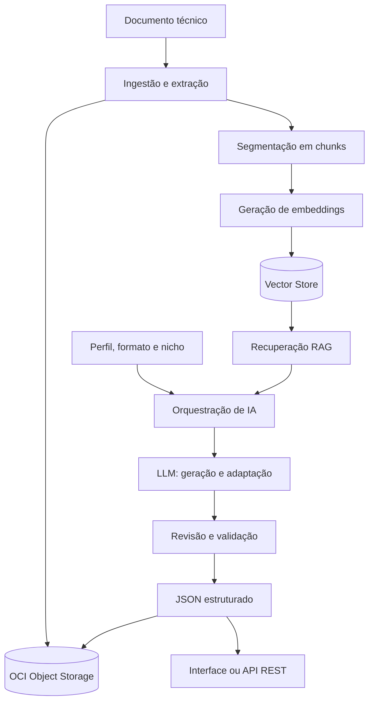

# 🎓 NovaMente

### Sistema Inteligente de Adaptação e Geração de Conteúdo Educacional

**Hackathon ONE G10 — Oracle Next Education & Alura**

> **Status do projeto:** Em planejamento — desenvolvimento ainda não iniciado.

## 📖 Sobre o projeto

O **NovaMente** é uma solução de tecnologia educacional (EdTech) que tem como objetivo transformar documentações técnicas, manuais de software, artigos e bases de conhecimento em conteúdos educacionais personalizados, utilizando **Inteligência Artificial Generativa, Retrieval-Augmented Generation (RAG) e orquestração de agentes inteligentes**.

A proposta é facilitar o aprendizado de conteúdos técnicos complexos, adaptando a linguagem, a profundidade e a estrutura pedagógica de acordo com o perfil do destinatário, o contexto de aplicação e o formato de aprendizagem desejado.

O projeto será desenvolvido no contexto do **Hackathon do Programa Oracle Next Education (ONE) — Grupo 10 - Equipe 6**, em parceria com a Alura.

## 🎯 Problema

Empresas, instituições de ensino e equipes de tecnologia frequentemente precisam capacitar profissionais utilizando documentações técnicas extensas e complexas.

Entretanto, um mesmo material pode ser difícil de compreender para determinados públicos devido ao uso de terminologias especializadas, diferentes níveis de conhecimento prévio e necessidades distintas de aprendizagem.

A adaptação manual desses conteúdos exige tempo e esforço de especialistas técnicos e profissionais de educação.

O NovaMente busca reduzir esse esforço, automatizando a transformação de documentos em materiais educacionais adequados a diferentes perfis, sem perder a fidelidade às informações originais.

## 🚀 Objetivo

Desenvolver um **Produto Mínimo Viável (MVP)** capaz de:

1. Receber e processar documentos técnicos nos formatos PDF, Markdown ou texto.
2. Extrair, segmentar e indexar o conteúdo utilizando técnicas de RAG.
3. Utilizar modelos de linguagem (LLMs) para adaptar materiais aos perfis e formatos solicitados.
4. Gerar conteúdos educacionais estruturados em JSON.
5. Avaliar a coerência didática e a fidelidade dos conteúdos gerados.
6. Disponibilizar uma interface interativa ou API REST funcional.
7. Persistir os documentos originais e os conteúdos gerados no **Oracle Cloud Infrastructure (OCI) Object Storage**, utilizando a camada Always Free.

## ✨ Funcionalidades previstas

### 1. Ingestão de documentos

O sistema deverá permitir a entrada de materiais técnicos nos seguintes formatos:

- PDF;
- Markdown;
- Texto simples.

Os documentos serão processados e preparados para utilização pelo mecanismo de recuperação de informações.

### 2. Personalização do conteúdo educacional

O usuário poderá configurar a adaptação do conteúdo utilizando diferentes parâmetros.

**Perfil do destinatário:**

- Iniciante ou profissional em transição de carreira;
- Desenvolvedor Júnior ou Pleno;
- Líder Técnico ou Arquiteto;
- Gestor ou Executivo não técnico.

**Formato pedagógico de saída:**

- Guia prático passo a passo (tutorial);
- Flashcards de memorização;
- Quiz interativo com justificativas;
- Resumo executivo (TL;DR);
- Roteiro de aula ou vídeo.

**Nicho ou contexto de aplicação:**

- Fintech;
- Saúde;
- E-commerce;
- Geral.

O sistema deverá adaptar a linguagem, os exemplos e a profundidade das explicações conforme os parâmetros selecionados.

### 3. Recuperação de informações com RAG

O NovaMente utilizará técnicas de **Retrieval-Augmented Generation (RAG)** para fundamentar os conteúdos educacionais nos documentos fornecidos.

O processamento deverá contemplar:

1. Extração do conteúdo textual.
2. Segmentação em trechos (*chunking*).
3. Geração de representações vetoriais (*embeddings*).
4. Armazenamento dos embeddings em uma base vetorial (*Vector Store*).
5. Recuperação dos trechos relevantes.
6. Utilização das informações recuperadas como contexto para a geração de conteúdo.

O objetivo é aumentar a fidelidade técnica e reduzir a ocorrência de informações não fundamentadas nos materiais originais.

### 4. Geração de conteúdo com IA

A aplicação utilizará modelos de linguagem para:

- Reescrever explicações técnicas;
- Adaptar a linguagem ao público;
- Criar exemplos contextualizados;
- Estruturar materiais pedagógicos;
- Identificar conceitos-chave e pré-requisitos;
- Estimar o tempo necessário para estudo;
- Avaliar a coerência didática.

A solução poderá utilizar modelos como Google Gemini, OpenAI, Anthropic Claude, Grok, Ollama ou alternativas equivalentes.

A escolha do provedor será definida durante o desenvolvimento.

### 5. Orquestração inteligente

O processamento poderá utilizar cadeias de prompts ou agentes inteligentes para organizar as etapas de geração.

Entre as responsabilidades previstas estão:

- Recuperar informações dos documentos;
- Planejar a estrutura pedagógica;
- Produzir o conteúdo adaptado;
- Revisar a coerência e a fidelidade das informações;
- Estruturar os resultados no formato esperado.

A arquitetura deverá incluir mecanismos de verificação destinados a mitigar alucinações e inconsistências.

### 6. Saída estruturada

Os resultados serão disponibilizados em **JSON estruturado**, permitindo sua utilização pela interface da aplicação ou integração com sistemas externos.

Os resultados deverão contemplar informações como:

- Perfil aplicado;
- Formato gerado;
- Conteúdo educacional adaptado;
- Conceitos-chave;
- Tempo estimado de estudo;
- Avaliação de qualidade;
- Informações de armazenamento.

## 🧠 Arquitetura conceitual

A solução será organizada em um fluxo de processamento que conecta a ingestão documental, a recuperação de informações e a geração de conteúdo educacional.

O diagrama representa a arquitetura conceitual planejada. Sua implementação poderá ser ajustada conforme as tecnologias selecionadas pela equipe.

## 🛠️ Tecnologias e ferramentas

A documentação oficial permite diferentes abordagens tecnológicas. As ferramentas abaixo são opções previstas ou recomendadas para o desenvolvimento.

| Categoria | Tecnologias e ferramentas |
|---|---|
| Linguagens e backend | Python, Node.js, FastAPI, Flask |
| Interface | Streamlit, Gradio ou alternativa equivalente |
| Modelos de linguagem | Gemini, OpenAI, Claude, Grok, Ollama ou equivalentes |
| Orquestração | LangChain, LangGraph |
| Processamento de PDF | PyPDF |
| Busca vetorial | ChromaDB, FAISS ou similar |
| Validação de dados | Pydantic, Structured Outputs |
| Armazenamento de arquivos | OCI Object Storage |
| Infraestrutura opcional | OCI Compute Always Free |

> **Nota:** as tecnologias definitivas serão escolhidas durante o planejamento e a implementação. A documentação do hackathon permite o uso de ferramentas equivalentes.

## ☁️ Oracle Cloud Infrastructure (OCI)

A utilização do **OCI Object Storage** é um requisito obrigatório do MVP.

O sistema deverá armazenar:

- Documentos técnicos originais enviados à aplicação;
- Arquivos JSON contendo os conteúdos educacionais gerados.

A integração poderá ser implementada utilizando os SDKs oficiais da OCI ou chamadas à API REST.

### Restrições de infraestrutura

O projeto deverá utilizar exclusivamente recursos abrangidos pela camada **Always Free** da OCI, evitando configurações que possam gerar custos monetários.

A hospedagem completa da aplicação em uma instância OCI Compute Always Free é considerada um diferencial opcional, não um requisito obrigatório.

## 📋 Requisitos mínimos do MVP

Os seguintes critérios deverão ser atendidos para a entrega do hackathon:

- [ ] Ingestão funcional de documentos PDF, Markdown ou texto.
- [ ] Implementação de RAG com chunking, embeddings e busca vetorial.
- [ ] Orquestração de prompts ou fluxos inteligentes utilizando uma LLM.
- [ ] Adaptação do mesmo conteúdo para pelo menos dois perfis diferentes.
- [ ] Geração de pelo menos dois formatos pedagógicos distintos.
- [ ] Disponibilização de saídas em JSON estruturado.
- [ ] Implementação de interface interativa ou API REST operacional.
- [ ] Integração funcional com OCI Object Storage na camada Always Free.
- [ ] Persistência dos documentos originais e conteúdos gerados.
- [ ] Apresentação de pelo menos três cenários de execução.
- [ ] Documentação do projeto no GitHub, incluindo arquitetura e fluxo de IA.

## 🌟 Diferenciais opcionais

A documentação do hackathon também apresenta funcionalidades que poderão ser desenvolvidas conforme a disponibilidade da equipe.

### Sistema multiagentes com LangGraph

Implementação de agentes especializados, como:

- Agente Pesquisador RAG;
- Agente Redator Pedagógico;
- Agente Crítico/Revisor.

### Quizzes com avaliação em tempo real

Disponibilização de uma interface na qual o estudante possa responder às questões geradas e receber feedback explicativo imediato.

### Suporte multimodal

Interpretação de diagramas técnicos presentes nos documentos originais.

### Exportação em múltiplos formatos

Possibilidade de exportar conteúdos educacionais em:

- Markdown;
- PDF formatado;
- CSV compatível com Anki.

### Deploy em OCI Compute

Hospedagem da aplicação em uma instância Linux utilizando recursos da camada Always Free da Oracle Cloud Infrastructure.

> Os itens desta seção são diferenciais opcionais e não fazem parte dos critérios mínimos obrigatórios.

## 🧪 Demonstração do projeto

A entrega deverá apresentar **no mínimo três cenários distintos de adaptação de um mesmo documento técnico**.

Os cenários deverão demonstrar como a inteligência artificial consegue adaptar a profundidade, a linguagem e a organização do conteúdo para diferentes públicos e formatos.

A documentação de cada execução poderá apresentar:

1. Documento técnico utilizado;
2. Perfil do destinatário;
3. Formato pedagógico solicitado;
4. Conteúdo gerado;
5. Evidências de fidelidade ao material original;
6. Resultado estruturado;
7. Persistência no OCI Object Storage.

## 📚 Formações relacionadas

Conforme o mapeamento do Programa ONE — Grupo 10, o projeto está associado às seguintes formações:

**Formações indispensáveis:**

- Inteligência de Dados e RAG Avançado;
- Oracle Cloud Infrastructure (OCI).

**Formações de reforço:**

- Engenharia de Agentes e Automação;
- Desarrollo y Orquestación con IA Generativa.

Essas formações fornecem a base conceitual para o desenvolvimento das funcionalidades de recuperação, geração, orquestração e armazenamento.

## ⚙️ Instalação e execução

O projeto encontra-se em fase inicial de planejamento.

As instruções de instalação, configuração das variáveis de ambiente, execução local e integração com a OCI serão documentadas conforme a implementação avançar.

## 📂 Estrutura do repositório

A estrutura de diretórios será definida conforme a arquitetura e as tecnologias selecionadas pela equipe.

Este README será atualizado para refletir a organização real do código-fonte.

## 🤝 Desenvolvimento colaborativo

O NovaMente será desenvolvido no contexto do **Hackathon ONE G10 — Oracle Next Education & Alura**.

O repositório será utilizado para colaboração, versionamento e documentação das atividades da equipe.

As contribuições deverão seguir as convenções de desenvolvimento e organização estabelecidas pelos participantes.

## 📄 Referência

A especificação funcional deste projeto está fundamentada no documento:

**Projeto 1 — NovaMente — Sistema Inteligente de Adaptação e Geração de Conteúdo Educacional**

Programa Oracle Next Education — Grupo 10  
Hackathon ONE G10 — Oracle Next Education & Alura

---

**NovaMente — Sistema Inteligente de Adaptação e Geração de Conteúdo Educacional.**