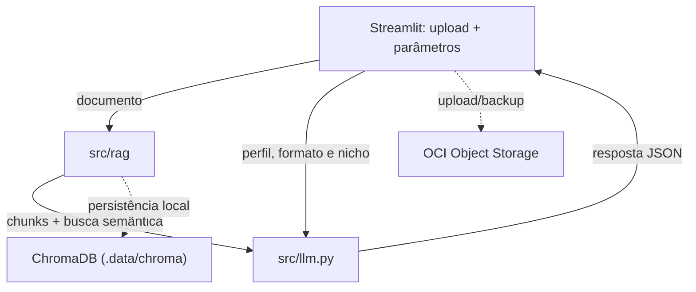

# 🎓 NovaMente

### Sistema Inteligente de Adaptação e Geração de Conteúdo Educacional

**Hackathon ONE G10 — Oracle Next Education & Alura**

> Status do projeto: MVP funcional em Python com interface Streamlit, RAG local em ChromaDB e integração com Google Gemini ou Ollama.

## 📖 Sobre o projeto

O **NovaMente** transforma documentos técnicos em materiais de estudo personalizados para diferentes perfis de aprendizagem. A aplicação recebe um PDF, Markdown ou texto, extrai o conteúdo relevante, indexa em um banco vetorial e gera um material pedagógico adaptado ao perfil do aluno, ao formato desejado e ao nicho de aplicação.

A solução combina:

- processamento de documentos em Python;
- RAG com ChromaDB e embeddings;
- orquestração do modelo com LangChain;
- geração de conteúdo em JSON estruturado;
- integração com Google Gemini e opção de execução local via Ollama;
- persistência de documentos e backups no Object Storage da OCI.

## 🚀 Objetivo do MVP

O MVP do NovaMente foi pensado para:

1. receber documentos técnicos em PDF, Markdown e TXT;
2. dividir e indexar o conteúdo em chunks para busca semântica;
3. adaptar o material para públicos como iniciante, técnico, gestor e executivo;
4. gerar flashcards, quizzes, resumo executivo ou tutorial passo a passo;
5. gravar os resultados e backups no OCI Object Storage;
6. permitir execução local e testes em Docker.

## 🛠️ Stack tecnológica

| Categoria | Tecnologias |
|---|---|
| Linguagem | Python 3.12 |
| Interface | Streamlit |
| Orquestração de IA | LangChain |
| LLM | Google Gemini + Ollama |
| RAG e vetores | ChromaDB + embeddings Hugging Face |
| Processamento de documentos | PyPDF |
| Armazenamento | OCI Object Storage |
| Containerização | Docker |
| Testes | pytest / unittest |

## 🧠 Fluxo funcional



## 📂 Estrutura do repositório

```text
g10_brasil_equipe6_novamente/
├── app.py                     # Aplicação principal em Streamlit
├── .env.example              # Template das variáveis de ambiente
├── .env                      # Arquivo local para configurações sensíveis (não versionar)
├── .gitignore                # Exclusões de arquivos locais e dados sensíveis
├── Dockerfile                # Imagem do container para rodar a app
├── requirements.txt          # Dependências do projeto
├── README.md                 # Documentação principal
├── Contrato_interno.md       # Documento interno da equipe
├── documents/               # Documentos de exemplo e testes
├── infra/
│   └── docker-compose.yml    # Emulador local da OCI
├── prompts_e_testes/         # Prompts e bases de teste
├── scripts/                 # Scripts auxiliares
├── src/
│   ├── llm.py               # Integração com Gemini/Ollama e geração JSON
│   ├── storage.py           # Comunicação com OCI Object Storage
│   ├── test_storage.py      # Teste de ciclo de vida do bucket
│   └── rag/
│       ├── document_loader.py
│       ├── embeddings.py
│       ├── pipeline.py
│       ├── retriever.py
│       ├── text_splitter.py
│       └── vector_store.py
├── tests/                   # Testes do projeto
├── .data/                   # Persistência local do ChromaDB
└── venv/                    # Ambiente virtual local do projeto
```

## ⚙️ Instalação e execução local

A seguir estão os passos reais para rodar o projeto na sua máquina.

### 1) Clone o repositório

```bash
git clone https://github.com/No-Country-simulation/g10_brasil_equipe6_novamente.git
cd g10_brasil_equipe6_novamente
```

### 2) Crie e ative um ambiente virtual

No Windows (PowerShell):

```powershell
python -m venv .venv
.\.venv\Scripts\Activate.ps1
```

No Windows (CMD):

```bat
python -m venv .venv
.\.venv\Scripts\activate.bat
```

No Linux/macOS:

```bash
python3 -m venv .venv
source .venv/bin/activate
```

### 3) Instale as dependências

```bash
python -m pip install --upgrade pip
pip install -r requirements.txt
```

### 4) Configure as variáveis de ambiente

Crie o arquivo `.env` a partir do template:

```bash
copy .env.example .env
```

ou, em Linux/macOS:

```bash
cp .env.example .env
```

Em seguida, preencha o `.env` com os valores reais do seu ambiente. O arquivo deve conter, no mínimo:

```env
GOOGLE_API_KEY=sua_api_key_google
GEMINI_MODEL=gemini-1.5-flash

BUCKET_NAME=nome-do-bucket
OCI_NAMESPACE=
OCI_CONFIG_FILE=~/.oci/config
OCI_PROFILE=DEFAULT

CHROMA_COLLECTION_NAME=novamente_documents
CHROMA_PERSIST_DIRECTORY=.data/chroma
```

Observações importantes:

- `GOOGLE_API_KEY` é necessária para usar o Google Gemini.
- `BUCKET_NAME` é obrigatório quando a aplicação tenta salvar arquivos no OCI.
- Se você for usar o emulador local, configure `OCI_ENDPOINT=http://localhost:12000` e `OCI_NAMESPACE=namespace_ficticio`.
- O arquivo `.env` não deve ser versionado.

### 5) Opção A: usar o Google Gemini (nuvem)

Se quiser rodar a aplicação com a API do Google, basta manter o valor padrão do ambiente e iniciar a aplicação:

```bash
streamlit run app.py
```

A interface ficará disponível em:

```text
http://localhost:8501
```

### 6) Opção B: usar Ollama localmente

O projeto também suporta execução local com Ollama. Para isso:

1. instale o Ollama na máquina;
2. baixe um modelo, por exemplo:

```bash
ollama pull llama3.1:8b
```

3. inicie o serviço:

```bash
ollama serve
```

4. na interface do Streamlit, no menu lateral, escolha:
   - `Local (Ollama)`
   - o modelo desejado na lista

A aplicação usará automaticamente o modelo selecionado para a geração do conteúdo.

### 7) Emulador local da OCI (opcional)

Se você quiser testar uploads e integração com o Object Storage sem acessar a nuvem, suba o emulador da OCI:

```bash
docker compose -f infra/docker-compose.yml up -d
```

Com isso, o SDK da OCI passa a apontar para `http://localhost:12000` quando `OCI_ENDPOINT` estiver definido no `.env`.

Exemplo:

```env
OCI_ENDPOINT=http://localhost:12000
OCI_NAMESPACE=namespace_ficticio
BUCKET_NAME=nome-teste-bucket
```

### 8) Execução em Docker

Também é possível rodar a aplicação em container:

```bash
docker build -t novamente-mente .
docker run --rm -p 8501:8501 --env-file .env novamente-mente
```

A app fica disponível em:

```text
http://localhost:8501
```

## ✅ Como validar o projeto

### Rodar a suite de testes

```bash
pytest
```

Se quiser testar diretamente o módulo de armazenamento da OCI:

```bash
python -m unittest src.test_storage
```

## 🤝 Regras de contribuição

1. nunca suba chaves e segredos para o GitHub;
2. mantenha o `.env` local e fora do controle de versão;
3. crie branches por tarefa e mantenha o escopo focado;
4. prefira alterações relacionadas ao módulo que você está trabalhando
   (`app.py`, `src/llm.py`, `src/rag/`, `src/storage.py`);
5. antes de enviar mudanças, teste a funcionalidade relevante e confirme que a aplicação ainda sobe corretamente.

---
*Projeto desenvolvido para o Hackathon ONE G10 — Oracle Next Education & Alura.*